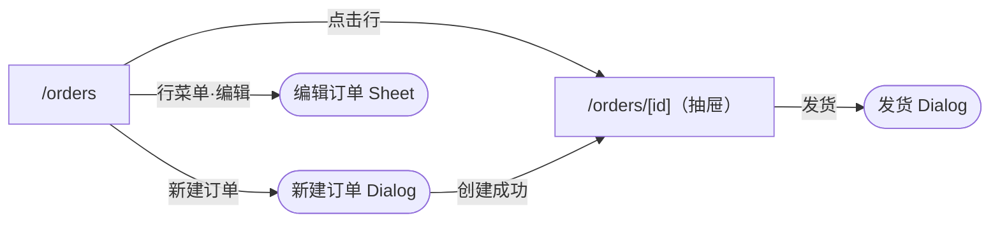

# Review summary

The user reviews this summary instead of the YAML. Produce it at the end of every Author run, in the response. When the blueprint has more than three pages, also write it to `blueprint/_summary.md`, regenerated on each run and never hand-edited.

Keep it short, factual, and free of YAML. Every line must be traceable to the blueprint; do not introduce anything the files do not say.

## Sections

1. **Pages** — one row per `page.md`: route, pattern (or `custom`), one-line purpose, and the main regions in reading order.
2. **Flow** — a Mermaid `flowchart LR` generated from `navigate()` and `open()` actions. Pages are boxes, overlays are rounded nodes, and edges are labeled with the trigger text.
3. **Overlays** — one row per overlay: where it opens from, type, trigger, outcomes, and what happens after each outcome.
4. **Deviations** — places where a page departs from its pattern or from app conventions, and why.
5. **Questions** — every `# assumed` item and open question, numbered so the user can answer by number ("1 同步下载；3 不包含退款"). Put questions that change structure first.

Omit an empty section. If the run only changed part of the blueprint, summarize the changed pages and note what stayed the same in one line.

## Example

````markdown
## 页面
| 路由 | 模式 | 用途 | 主要区块 |
| --- | --- | --- | --- |
| /orders | list | 查找、筛选、批量处理订单 | 统计卡片 → 状态 Tabs + 搜索 + 日期 → 订单表格 → 批量操作栏 |
| /orders/[id] | custom | 查看订单并发货 | 标题 + 状态 → 基本信息 → 商品表 → 物流 |

## 流转


## 弹层
| 所在页面 | 弹层 | 类型 | 触发 | 结果 → 之后 |
| --- | --- | --- | --- | --- |
| /orders | 新建订单 | Dialog | 顶栏「新建订单」 | 创建成功 → 刷新列表、提示、进入详情 |
| /orders | 编辑订单 | Sheet 右 | 行菜单「编辑」 | 已保存 → 刷新列表、提示 |
| /orders/[id] | 发货 | Dialog | 顶栏「发货」（已支付且有权限） | 已发货 → 刷新详情 |

## 偏离
- /orders：在标准列表上方加了统计卡片；点击卡片切换状态筛选。

## 待确认
1. 导出是同步下载还是异步任务？（当前假设异步）
2. 金额单位是分吗？（当前假设是）
3. 「今日成交额」是否包含已退款订单？
````
